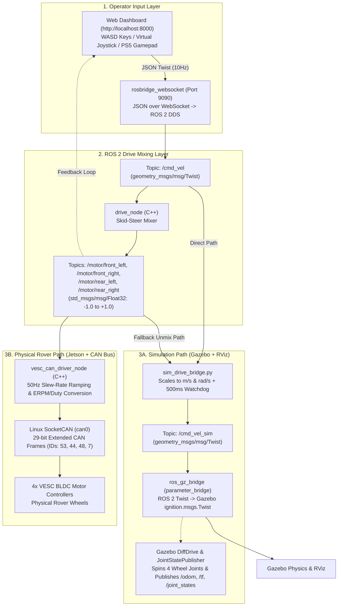

# D.A.V.E. ROS 2 Team Demo & Walkthrough Guide

This presenter's guide walks through a complete live demonstration of how data flows through **D.A.V.E.'s ROS 2 architecture**—starting from a button press or controller input in the **Web Dashboard**, passing through `drive_node`, and branching out to either the **Simulated Gazebo Wheels** or the **Physical VESC CAN Bus Wheels**.

It also covers the critical ROS 2 configurations and middleware quirks every team member should know before writing or debugging nodes.

---

## 0. Pre-Demo Preparation Checklist

### A. Files to Open in VS Code Tabs (In Order of Presentation)
Open these 8 files in your editor before starting the presentation so you can click through them in sequence:

1. **[`dashboard/app.js`](../../../dashboard/app.js)** — Browser input capture (`WASD` / PS5 Gamepad) & WebSocket publishing to `/cmd_vel`.
2. **[`ros2_ws/src/drive_package/src/drive_node.cpp`](../drive_package/src/drive_node.cpp)** — Skid-steer mixer converting `/cmd_vel` into 4 wheel topics (`/motor/*`).
3. **[`ros2_ws/src/rover_description/scripts/sim_drive_bridge.py`](scripts/sim_drive_bridge.py)** — *(Sim Path)* Bridge converting `/cmd_vel` and `/motor/*` to `/cmd_vel_sim`.
4. **[`ros2_ws/src/rover_description/launch/sim.launch.py`](launch/sim.launch.py)** — *(Sim Path)* `ros_gz_bridge` mapping between ROS 2 DDS and Gazebo Transport.
5. **[`ros2_ws/src/rover_description/urdf/gazebo_control.xacro`](urdf/gazebo_control.xacro)** — *(Sim Path)* Gazebo `DiffDrive` and `JointStatePublisher` physics plugins.
6. **[`ros2_ws/src/drive_package/src/vesc_can_driver_node.cpp`](../drive_package/src/vesc_can_driver_node.cpp)** — *(Hardware Path)* Linux SocketCAN driver converting `/motor/*` into VESC CAN frames on `can0`.
7. **[`fastdds_profiles.xml`](../../../fastdds_profiles.xml)** — Hybrid DDS network discovery configuration.
8. **[`ros2_ws/src/rover_description/rviz/default.rviz`](rviz/default.rviz)** — RViz QoS durability and coordinate frame configuration.

### B. Terminals to Open
* **Terminal 1 (System Launcher):** At the repository root (`D.A.V.E.`) ready to run `./start_sim_system.sh`.
* **Terminal 2 (Live Inspector):** Sourced with ROS 2 Humble and workspace (`source /opt/ros/humble/setup.bash && source ros2_ws/install/setup.bash`) for running `ros2 topic list` and `ros2 topic echo`.

---

## 1. The Big Picture: Unified Input, Dual Backend

Start by showing the team this mental model: **the frontend and drive mixer do not care whether the rover is simulated or physical.** Both simulation and real hardware share the exact same upstream pipeline and split only at the final actuator stage:



---

## 2. Step-by-Step Live Walkthrough & Code References

### Step 1: Launch & Show Discovery in Terminal
1. In **Terminal 2**, before starting the system, run:
   ```bash
   ros2 topic list
   ```
   *Point out that only the default ROS 2 infrastructure topics (`/parameter_events`, `/rosout`) exist.*
2. In **Terminal 1**, start the full system:
   ```bash
   ./start_sim_system.sh
   ```
   *Open [`start_sim_system.sh`](../../../start_sim_system.sh#L40-L60) and show lines **40–60**: this single script starts 4 things: `rosbridge_websocket` (port 9090), `dashboard_helper` (process manager backend), Python `http.server` (port 8000), and `sim.launch.py` (Gazebo, RViz, `robot_state_publisher`, `drive_node`, and `sim_drive_bridge`).*
3. In **Terminal 2**, run `ros2 topic list` again so the team sees all 21 topics appear live.

---

### Step 2: Dashboard Input $\rightarrow$ `/cmd_vel`
**Open File:** [`dashboard/app.js`](../../../dashboard/app.js)

1. **WebSocket Connection ([Lines 179–238](../../../dashboard/app.js#L179-L238) & [Line 1338](../../../dashboard/app.js#L1338)):**
   * Explain that browsers cannot speak native ROS 2 DDS UDP packets directly. Instead, `app.js` uses `ROSLIB.Ros` to open a WebSocket connection to `ws://localhost:9090` (`rosbridge_websocket`).
2. **Advertising `/cmd_vel` ([Lines 241–246](../../../dashboard/app.js#L241-L246)):**
   * Show `cmdVelPub`: declares a publisher on topic `/cmd_vel` with type `geometry_msgs/msg/Twist`.
3. **Reading Controller / Keyboard Inputs ([Lines 774–895](../../../dashboard/app.js#L774-L895)):**
   * Show `startControlLoopTimer()`: runs every `100ms` (10 Hz).
   * **Lines 790–802:** Reads the browser Gamepad API—Left Stick X (`gp.axes[0]`) for steering, Left Stick Y (`gp.axes[1]`) or `R2`/`L2` triggers (`gp.buttons[7]` / `gp.buttons[6]`) for throttle.
   * **Lines 843–847:** Computes `linearSpeed` and `angularSpeed`.
   * **Lines 967–1004:** Shows `calculateKeyboardVelocities()`, which does the exact same calculation if using `W/A/S/D` or arrow keys.
4. **Publishing the Message ([Lines 1006–1014](../../../dashboard/app.js#L1006-L1014)):**
   * Show `publishDriveCommand()`: packages `linear.x` (forward/back) and `angular.z` (yaw turn) into a `ROSLIB.Message` and calls `cmdVelPub.publish(msg)`.

**Live Demo Action:**
In **Terminal 2**, run:
```bash
ros2 topic echo /cmd_vel
```
Press `W` or pull `R2` in the dashboard at `http://localhost:8000` and show the live `linear.x` and `angular.z` values streaming in the terminal.

---

### Step 3: Drive Node Mixing (`/cmd_vel` $\rightarrow$ `/motor/*`)
**Open File:** [`ros2_ws/src/drive_package/src/drive_node.cpp`](../drive_package/src/drive_node.cpp)

1. **Subscriptions & Publishers ([Lines 16–32](../drive_package/src/drive_node.cpp#L16-L32)):**
   * Show that `JoyDrive` (`drive_node`) subscribes to both `/joy` (native Linux controller) and `/cmd_vel` (dashboard/keyboard/autonomy).
   * Show lines **28–31**: creates 4 `std_msgs/msg/Float32` publishers: `/motor/front_left`, `/motor/front_right`, `/motor/rear_left`, `/motor/rear_right`.
2. **Skid-Steer Mixing Logic ([Lines 112–137](../drive_package/src/drive_node.cpp#L112-L137)):**
   * Focus on `cmdVelCallback` (lines **118–122**):
     ```cpp
     float left = throttle - steering;
     float right = throttle + steering;
     left  = std::clamp(left,  -1.0f, 1.0f);
     right = std::clamp(right, -1.0f, 1.0f);
     ```
   * Explain how differential/skid-steer turning works: positive `steering` (`angular.z > 0`, turning left) slows/reverses the left wheels and speeds up the right wheels, clamped between `-1.0` (-100% reverse) and `+1.0` (+100% forward).
   * **Lines 130–133:** Publishes those normalized floats to all 4 `/motor/*` topics.
3. **Closed-Loop UI Feedback ([`dashboard/app.js` Lines 432–466](../../../dashboard/app.js#L432-L466)):**
   * Flip back to `dashboard/app.js` lines **432–466** and **492–517**: point out that the dashboard's 4 wheel power bars do **not** just display your local key press—they actually subscribe to `/motor/front_left`, etc. coming back from `drive_node`! If `drive_node` is stopped in the Process Manager, the power bars won't move.

**Live Demo Action:**
In **Terminal 2**, run:
```bash
ros2 topic echo /motor/front_left
```
Drive forward and turn in the dashboard to show the float output changing between `-1.0` and `1.0`.

---

### Step 4A: How Topics Reach the *Simulated* Wheels (Gazebo & RViz)
Now explain what happens to those commands inside the simulator across 3 files:

#### 1. [`ros2_ws/src/rover_description/scripts/sim_drive_bridge.py`](scripts/sim_drive_bridge.py)
* **Lines 19–26:** Declares `max_linear_speed` (`1.5 m/s`) and `max_angular_speed` (`2.0 rad/s`).
* **Lines 40–49:** Subscribes to `/motor/*` and `/cmd_vel`, and creates a publisher on `/cmd_vel_sim`.
* **Lines 72–79 (`cb_cmd_vel`):** Scales normalized `/cmd_vel` inputs by `max_lin` and `max_ang` and publishes directly to `/cmd_vel_sim`.
* **Lines 81–108 (`update_and_publish`):**
  * **Lines 89–102:** If `/joy` is used instead of `/cmd_vel`, unmixes the 4 `/motor/*` topics back into a `Twist` message.
  * **Lines 103–107:** Safety watchdog—if inputs stop arriving for more than `0.5s`, publishes an explicit zero-velocity `Twist` so the rover doesn't coast forever in Gazebo.

#### 2. [`ros2_ws/src/rover_description/launch/sim.launch.py`](launch/sim.launch.py)
* **Lines 66–79 (`ros_gz_bridge`):**
  * Explain that Gazebo Fortress has its own internal C++ transport layer (`ignition.msgs`).
  * `parameter_bridge` translates ROS 2 messages to/from Gazebo messages:
    * `]` means **ROS 2 $\rightarrow$ Gazebo**: `/cmd_vel_sim@geometry_msgs/msg/Twist]ignition.msgs.Twist`
    * `[` means **Gazebo $\rightarrow$ ROS 2**: `/odom`, `/clock`, `/tf`, `/joint_states`.

#### 3. [`ros2_ws/src/rover_description/urdf/gazebo_control.xacro`](urdf/gazebo_control.xacro)
* **Lines 7–40 (`DiffDrive` plugin):**
  * **Lines 12–17:** Binds the 4 URDF wheel joints (`front_left_wheel_joint`, `rear_left_wheel_joint`, `front_right_wheel_joint`, `rear_right_wheel_joint`).
  * **Lines 34–39:** Listens to `/cmd_vel_sim` inside Gazebo, applies torque to spin the 4 wheels in the physics engine, and outputs odometry to `/odom` and the chassis pose (`odom -> base_footprint`) to `/tf` at 50 Hz.
* **Lines 43–52 (`JointStatePublisher` plugin):**
  * Reads the simulated wheel rotation angles at 50 Hz and publishes them to `/joint_states`.
  * `robot_state_publisher` reads `/joint_states` and updates `/tf`, which makes the wheels visibly spin in **RViz2**.

---

### Step 4B: How the Exact Same Topics Reach the *Physical* Wheels (CAN Bus)
**Open File:** [`ros2_ws/src/drive_package/src/vesc_can_driver_node.cpp`](../drive_package/src/vesc_can_driver_node.cpp)

Explain to the team that on the real rover, `drive_node` doesn't change at all—instead of `sim_drive_bridge.py`, we run `vesc_can_driver_node`:

1. **Wheel CAN IDs & Shared Parameters ([Lines 25–46](../drive_package/src/vesc_can_driver_node.cpp#L25-L46)):**
   * Uses Linux network interface `can0`.
   * Each physical VESC motor controller has a unique hardware CAN ID (lines **35–38**):
     * Front Left: `53`
     * Front Right: `44`
     * Rear Left: `48`
     * Rear Right: `7`
   * Loads `wheel_radius` (`0.15 m`) from the shared [`physical_params.yaml`](config/physical_params.yaml#L10) via `loadWheelRadiusFromConfig()` so simulation and hardware stay in sync unless overridden by ROS parameter.
2. **Subscribing to `/motor/*` ([Lines 94–117](../drive_package/src/vesc_can_driver_node.cpp#L94-L117)):**
   * Subscribes to the exact same `/motor/front_left`, `/motor/front_right`, `/motor/rear_left`, `/motor/rear_right` topics published by `drive_node` and stores them in `target_fl_`, `target_fr_`, `target_rl_`, `target_rr_`.
3. **50 Hz Slew-Rate Ramping ([Lines 120–123](../drive_package/src/vesc_can_driver_node.cpp#L120-L123) & [Lines 243–272](../drive_package/src/vesc_can_driver_node.cpp#L243-L272)):**
   * Rather than slamming the physical gearboxes with instantaneous 0% to 100% torque spikes, `updateLoop()` runs at 50 Hz and smoothly ramps `current_fl_` toward `target_fl_` based on `ramp_rate_` (`rampValue()`).
4. **Control Mode Conversion ([Lines 274–333](../drive_package/src/vesc_can_driver_node.cpp#L274-L333)):**
   * Supports 3 VESC modes:
     * **`erpm` mode (Lines 281–315):** Converts target velocity (`m/s`) into electrical RPM using `wheel_radius` from [`physical_params.yaml`](config/physical_params.yaml#L10) (`0.15m`), motor pole pairs (`2`), and gearbox ratio (`50:1`), and sends VESC command ID `3` (`CAN_PACKET_SET_RPM`). When stopped (`< 0.01`), it sends `CAN_PACKET_SET_CURRENT = 0` (lines **296–300**) so the motors relax instead of jittering at 0 RPM.
     * **`current` mode (Lines 316–320):** Multiplies by `max_current` (`14A * 1000`) with command ID `1` (`CAN_PACKET_SET_CURRENT`).
     * **`duty` mode (Lines 321–330):** Scales by `max_duty` (`0.95 * 100000`) with command ID `0` (`CAN_PACKET_SET_DUTY`).
5. **Packing & Transmitting the Raw 29-Bit Extended CAN Frame ([Lines 173–241](../drive_package/src/vesc_can_driver_node.cpp#L173-L241)):**
   * **Lines 173–211 (`initCanSocket`):** Opens a raw Linux `PF_CAN` socket on `can0` in non-blocking mode (`O_NONBLOCK`).
   * **Lines 214–241 (`sendVescCanFrame`):** Packs the 29-bit extended CAN identifier (`(comm_id << 8) | can_id | CAN_EFF_FLAG`), big-endian encodes the 32-bit integer payload into `frame.data[0..3]`, and writes the `can_frame` struct directly to the Linux kernel CAN bus socket.

---

## 3. ROS 2 Configurations & Quirks to Explain to the Team

Use this section at the end of the demo to save your teammates hours of debugging common ROS 2 pitfalls:

### Quirk 1: FastDDS Discovery & The "4-Node Unicast Trap"
* **Reference File:** [`fastdds_profiles.xml` (Lines 15–38)](../../../fastdds_profiles.xml#L15-L38) and [`start_sim_system.sh` (Line 7)](../../../start_sim_system.sh#L7)
* **What to explain:**
  1. **Why we disable Shared Memory (`<useBuiltinTransports>false</useBuiltinTransports>`):** FastDDS's default POSIX Shared Memory (`SHM`) transport on Ubuntu can leave locked files in `/dev/shm` when a node crashes or is killed, blocking future nodes from talking. Forcing `udp_transport` with 1 MB buffers solves this.
  2. **Why we need Hybrid Discovery (`239.255.0.1` + Unicast IPs):** Long-range directional Wi-Fi antennas between the base station (`192.168.1.88`) and rover Jetson (`192.168.1.87`) often drop multicast packets, so we list their unicast IPs. However, in FastDDS, unicast IPs without explicit port numbers only probe the first **4 participant IDs** (`7410–7416`). By also including `239.255.0.1` (multicast) in `<metatrafficMulticastLocatorList>` and `<initialPeersList>`, local nodes (like our 8+ simulation nodes) can discover an unlimited number of peers while keeping the unicast fallback for the field antenna.

### Quirk 2: QoS (Quality of Service) Mismatches Silently Drop Data
* **Reference Files:**
  * [`drive_node.cpp` (Lines 12–26)](../drive_package/src/drive_node.cpp#L12-L26)
  * [`default.rviz` (Lines 198–204)](rviz/default.rviz#L198-L204)
* **What to explain:**
  * Unlike ROS 1, ROS 2 publishers and subscribers have **QoS policies** (Reliability and Durability). If a publisher and subscriber have incompatible QoS, **ROS 2 will not throw an error—they just silently ignore each other.**
  * **Example in our codebase:** `robot_state_publisher` publishes the URDF model on `/robot_description` only **once** at startup using `Durability: Transient Local` (which latches the last message for late joiners). In [`default.rviz` line 200](rviz/default.rviz#L200), RViz's `RobotModel` display **must** be set to `Durability Policy: Transient Local`—when it was set to `Volatile`, RViz missed the startup message and rendered an empty screen.

### Quirk 3: Simulation Time (`use_sim_time`) vs. Wall-Clock Time
* **Reference Files:**
  * [`sim.launch.py` (Lines 74–79 & 87–108)](launch/sim.launch.py#L74-L108)
  * [`sim_drive_bridge.py` (Lines 34–37 & 82)](scripts/sim_drive_bridge.py#L34-L82)
* **What to explain:**
  * In simulation, Gazebo publishes simulated time on `/clock`. Nodes launched with `use_sim_time:=true` use `/clock` for ROS timers and TF timestamps instead of the computer's wall clock.
  * **Gotcha 1:** Never pass `use_sim_time:=true` to `parameter_bridge` itself ([`sim.launch.py` line 66](launch/sim.launch.py#L66)), because `parameter_bridge` is the node that bridges `/clock` from Gazebo into ROS 2!
  * **Gotcha 2:** For safety watchdogs (like checking if `/cmd_vel` timed out in [`sim_drive_bridge.py` line 82](scripts/sim_drive_bridge.py#L82)), using Python's wall-clock `time.monotonic()` prevents the watchdog from freezing if Gazebo is paused or experiences sim-time jitter.

### Quirk 4: TF2 Single-Parent Rule (Why Not to Run `Motion Coordinator` in Gazebo)
* **Reference Files:**
  * [`gazebo_control.xacro` (Lines 36–38)](urdf/gazebo_control.xacro#L36-L38)
  * [`motion_coordinator_node.py` (Lines 188–216)](../arm_controller/arm_controller/motion_coordinator_node.py#L188-L216)
* **What to explain:**
  * In ROS 2 TF2, every coordinate frame forms a strict tree where each child frame can only have **one parent**.
  * In Gazebo simulation, the TF chain is `odom -> base_footprint -> base_link -> *_wheel_link`.
  * [`motion_coordinator_node.py`](../arm_controller/arm_controller/motion_coordinator_node.py#L204-L216) is a standalone kinematic simulator that broadcasts `world -> base_link` and fake `/joint_states`. If someone clicks **START** on `Motion Coordinator` in the dashboard while Gazebo is running, `base_link` gets two competing parents (`base_footprint` and `world`), which breaks the TF tree in RViz.

### Quirk 5: How the Dashboard Process Manager Tracks Nodes
* **Reference File:** [`dashboard_helper_node.py` (Lines 27–51 & 168–195)](../arm_controller/arm_controller/dashboard_helper_node.py#L27-L51)
* **What to explain:**
  * When team members add a new node that they want controllable from the web dashboard UI, they register its command and `pgrep` pattern in `self.processes` inside [`dashboard_helper_node.py`](../arm_controller/arm_controller/dashboard_helper_node.py#L27-L149).
  * `dashboard_helper` checks `pgrep -f <pattern>` once per second ([`is_running` on line 168](../arm_controller/arm_controller/dashboard_helper_node.py#L168)) and publishes the status JSON to `/process_manager/status`. That is why `Robot State Publisher` and `Drive Node` automatically light up green as **RUNNING** when `sim.launch.py` starts them!

---

## 4. Handy Live Commands Cheat Sheet (For Q&A)

Keep these ready in **Terminal 2** if teammates ask questions during the demo:

```bash
# 1. List all currently active topics and their message types
ros2 topic list -t

# 2. See which nodes are publishing and subscribing to a specific topic (plus QoS)
ros2 topic info /motor/front_left -v

# 3. Watch live velocity commands coming from the dashboard
ros2 topic echo /cmd_vel

# 4. Watch live scaled velocity commands entering Gazebo
ros2 topic echo /cmd_vel_sim

# 5. Measure the publishing frequency (Hz) of Gazebo odometry or joint states
ros2 topic hz /odom
ros2 topic hz /joint_states

# 6. Manually inject a drive command from the terminal without the dashboard
ros2 topic pub --rate 10 /cmd_vel geometry_msgs/msg/Twist "{linear: {x: 0.5}, angular: {z: 0.3}}"
```
