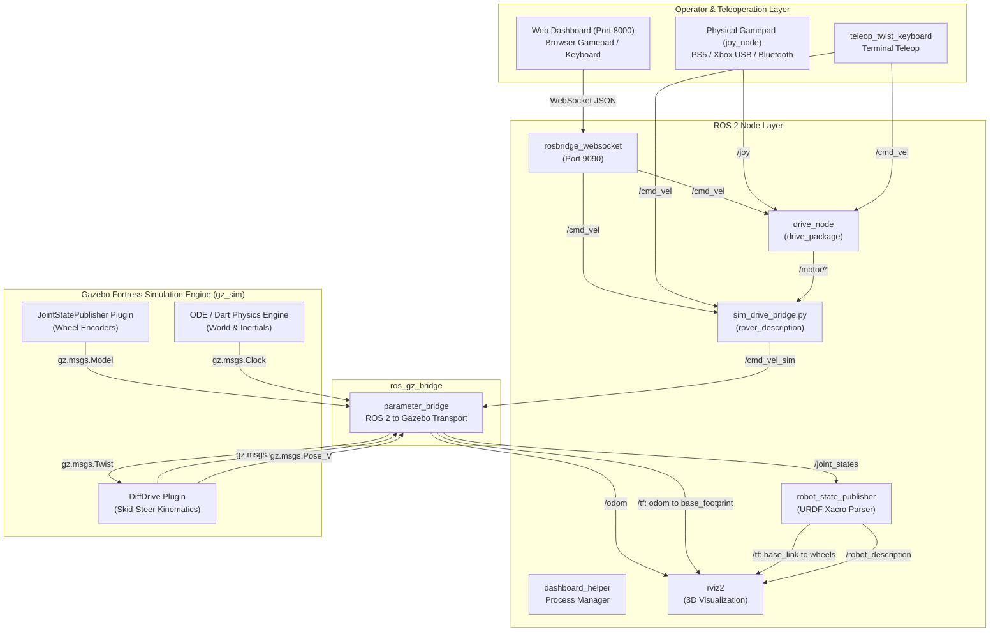
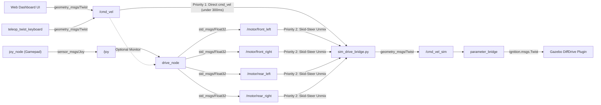

# D.A.V.E. Simulation Architecture & Developer Guide

This document provides a comprehensive technical breakdown of the simulation architecture for the **D.A.V.E. (Dry-land Autonomous Vehicular Explorer)** rover inside the [`rover_description`](.) package.

It covers end-to-end data pipelines, topic routing, middleware/DDS configuration, coordinate frame hierarchies (TF2), Gazebo Fortress plugins, and step-by-step instructions for future developers to extend the platform with new sensors, worlds, actuators, and autonomous software stacks.

---

## Table of Contents
1. [High-Level Architecture Overview](#1-high-level-architecture-overview)
2. [Process & Node Graph Topology](#2-process--node-graph-topology)
3. [Topic Flow & Bridge Routing](#3-topic-flow--bridge-routing)
4. [Coordinate Frames & TF Hierarchy](#4-coordinate-frames--tf-hierarchy)
5. [Key Configurations & Root-Cause Resolutions](#5-key-configurations--root-cause-resolutions)
6. [Component-by-Component Deep Dive](#6-component-by-component-deep-dive)
7. [Developer Extension Guide](#7-developer-extension-guide)

---

## 1. High-Level Architecture Overview

The simulation environment is built on **ROS 2 Humble Hawksbill** and **Modern Gazebo (Gazebo Fortress / `gz-sim`)** connected via the official [`ros_gz_bridge`](https://github.com/gazebosim/ros_gz).

The design follows three core architectural principles:
* **Hardware-Simulation Parity:** The simulation accepts the exact same velocity and motor control topics used by the physical rover hardware. Control algorithms (teleoperation, autonomous navigation, state estimators) run unchanged regardless of whether the backend is real VESC motor controllers or Gazebo physics.
* **Separation of Concerns:** Heavy physics calculations remain isolated inside Gazebo's multi-threaded simulation engine. Inter-process bridging translates native Gazebo Protobuf transport messages into ROS 2 standard messages.
* **Deterministic Initialization:** The robot model is parsed directly from Xacro into XML at launch time and injected directly into Gazebo via string arguments to prevent topic lookup race conditions during startup.



---

## 2. Process & Node Graph Topology

When executing [`./start_sim_system.sh`](../../../start_sim_system.sh), the following coordinated processes are launched:

| Process / Executable | Package / Runtime | Primary Function | Output Log |
| :--- | :--- | :--- | :--- |
| `rosbridge_websocket` | `rosbridge_server` | Bidirectional WebSocket interface on port 9090 between browser client and ROS 2 topics/services. | `/tmp/rosbridge_sim.log` |
| `dashboard_helper` | `arm_controller` | Subscribes to system state, monitors running PIDs, exposes `SetBool` toggle services for nodes. | `/tmp/dashboard_helper.log` |
| `http.server` | Python 3 | Serves HTML/CSS/JS frontend dashboard on `http://localhost:8000`. | `/tmp/webserver_sim.log` |
| `gz_sim` (Fortress) | `ros_gz_sim` | Simulates rigid-body physics, collisions, surface friction, contact dynamics, and Gazebo transport. | `/tmp/gazebo_sim.log` |
| `create` (Spawner) | `ros_gz_sim` | Injects the evaluated URDF model XML into the running Gazebo world. | `/tmp/gazebo_sim.log` |
| `robot_state_publisher` | `robot_state_publisher` | Computes 3D forward kinematics, broadcasts static transforms and dynamic wheel transforms. | `/tmp/gazebo_sim.log` |
| `parameter_bridge` | `ros_gz_bridge` | Bidirectional transport bridge between ROS 2 DDS topics and Gazebo Ignition topics. | `/tmp/gazebo_sim.log` |
| `rviz2` | `rviz2` | Visualizes the TF coordinate tree, URDF meshes, wheel rotations, and odometry trajectory. | Stderr / GUI |
| `drive_node` | `drive_package` | Translates raw joystick trigger/stick inputs or `/cmd_vel` into normalized individual motor commands. | `/tmp/gazebo_sim.log` |
| `sim_drive_bridge` | `rover_description` | Harmonizes teleop `/cmd_vel` and discrete `/motor/*` topics into `/cmd_vel_sim` for Gazebo. | `/tmp/gazebo_sim.log` |

---

## 3. Topic Flow & Bridge Routing

### 3.1 ROS 2 $\leftrightarrow$ Gazebo Bridged Topics

The [`ros_gz_bridge`](launch/sim.launch.py#L66-L79) node manages cross-middleware communication using the following parameter mapping:

| ROS 2 Topic | ROS 2 Message Type | Direction | Gazebo Transport Topic | Gazebo Message Type | Purpose |
| :--- | :--- | :---: | :--- | :--- | :--- |
| `/cmd_vel_sim` | `geometry_msgs/msg/Twist` | ROS $\rightarrow$ GZ | `/cmd_vel_sim` | `ignition.msgs.Twist` | Commanded linear $x$ and angular $z$ velocity into the Gazebo skid-steer plugin. |
| `/odom` | `nav_msgs/msg/Odometry` | GZ $\rightarrow$ ROS | `/odom` | `ignition.msgs.Odometry` | Wheel-encoder integrated odometry pose and twist calculated by Gazebo physics. |
| `/clock` | `rosgraph_msgs/msg/Clock` | GZ $\rightarrow$ ROS | `/clock` | `ignition.msgs.Clock` | Simulation clock synchronization for all nodes with `use_sim_time:=true`. |
| `/tf` | `tf2_msgs/msg/TFMessage` | GZ $\rightarrow$ ROS | `/tf` | `ignition.msgs.Pose_V` | Gazebo publishes the transform between world/odometry and `base_footprint`. |
| `/joint_states` | `sensor_msgs/msg/JointState` | GZ $\rightarrow$ ROS | `/joint_states` | `ignition.msgs.Model` | Angular position, velocity, and effort of the four continuous wheel joints. |

### 3.2 Drive Control Topic Hierarchy

Driving the simulated rover can occur via multiple sources. The arbitration is handled inside [`sim_drive_bridge.py`](scripts/sim_drive_bridge.py):



* **Direct `/cmd_vel` Pathway:** When the web dashboard or autonomous navigator sends velocity directly to `/cmd_vel`, [`SimDriveBridge.cb_cmd_vel()`](scripts/sim_drive_bridge.py#L72-L79) instantly scales and forwards it to `/cmd_vel_sim`. This provides responsive, zero-latency control.
* **Skid-Steer Unmixing Pathway:** If a physical gamepad publishes to `/joy`, [`drive_node`](../drive_package/src/drive_node.cpp) computes 4 individual wheel throttle percentages ($-1.0$ to $+1.0$) on `/motor/*`. [`SimDriveBridge.update_and_publish()`](scripts/sim_drive_bridge.py#L81-L108) reconstructs linear and angular velocity via:
  $$\text{left} = \frac{\text{fl} + \text{rl}}{2}, \quad \text{right} = \frac{\text{fr} + \text{rr}}{2}$$
  $$\text{throttle} = \frac{\text{left} + \text{right}}{2}, \quad \text{steering} = \frac{\text{right} - \text{left}}{2}$$
* **Safety Watchdog / Auto-Stop:** If no command is received on either `/cmd_vel` or `/motor/*` within 500 ms, [`sim_drive_bridge.py`](scripts/sim_drive_bridge.py#L103-L108) issues a zero-velocity `Twist` to prevent runaway motion in Gazebo.

---

## 4. Coordinate Frames & TF Hierarchy

The simulation adheres strictly to [REP-105 (Coordinate Frames for Mobile Platforms)](https://www.ros.org/reps/rep-0105.html) and [REP-120](https://www.ros.org/reps/rep-0120.html).

```
odom  (World odometry reference, published by Gazebo DiffDrive)
 └── base_footprint  (Projected onto ground plane, Z=0)
      └── base_link  (Main chassis frame, elevated by wheel_radius = 0.15m)
           ├── front_left_wheel_link   (Joint: continuous, dynamic rotation)
           ├── front_right_wheel_link  (Joint: continuous, dynamic rotation)
           ├── rear_left_wheel_link    (Joint: continuous, dynamic rotation)
           └── rear_right_wheel_link   (Joint: continuous, dynamic rotation)
```

### Transform Responsibilities
1. **`odom` $\rightarrow$ `base_footprint`:** Published dynamically by the Gazebo [`DiffDrive`](urdf/gazebo_control.xacro#L7-L40) system plugin via Gazebo topic `/tf`, mapped to ROS 2 `/tf` by `parameter_bridge`.
2. **`base_footprint` $\rightarrow$ `base_link`:** Defined in [`rover.urdf.xacro`](urdf/rover.urdf.xacro#L45-L50) as a fixed joint with an offset of $z = \text{wheel\_radius} = 0.15\,\text{m}$. Broadcast by [`robot_state_publisher`](launch/sim.launch.py#L41-L50).
3. **`base_link` $\rightarrow$ `*_wheel_link`:** Defined as continuous revolute joints in [`rover.urdf.xacro`](urdf/rover.urdf.xacro#L78-L115). Gazebo's [`JointStatePublisher`](urdf/gazebo_control.xacro#L43-L52) measures real wheel angles and publishes them to `/joint_states`. [`robot_state_publisher`](launch/sim.launch.py#L41-L50) computes the forward kinematics and broadcasts the dynamic wheel transforms to `/tf`.

> [!WARNING]
> **Single Parent Tree Rule:** In ROS TF2, every coordinate frame can only have **one** parent.
> Standalone kinematic nodes such as [`motion_coordinator_node.py`](../arm_controller/arm_controller/motion_coordinator_node.py) attempt to broadcast a conflicting `world -> base_link` transform. **Do not run `motion_coordinator` while Gazebo is active**, as conflicting transforms will cause severe flickering and broken TF lookups in RViz.

---

## 5. Key Configurations & Root-Cause Resolutions

During development and testing, several critical bugs were diagnosed and permanently resolved. Future developers must be aware of these configuration choices:

### 5.1 FastDDS Hybrid Profile Resolution (Multi-Node Scaling)
* **Symptom:** RViz reported `Fixed Frame: No tf data. Actual error: Frame [base_link] does not exist`, and Gazebo did not receive drive commands when all nodes were started from [`start_sim_system.sh`](../../../start_sim_system.sh).
* **Root Cause:** [`fastdds_profiles.xml`](../../../fastdds_profiles.xml) originally defined an `<initialPeersList>` using purely unicast IP addresses (`127.0.0.1`, `192.168.1.87`, etc.) without port numbers, while disabling builtin transports. In FastDDS, unicast peers without explicit ports only probe the first 4 participant IDs (IDs `0, 1, 2, 3` on ports `7410, 7412, 7414, 7416`). When running 8+ nodes simultaneously, participants 4 through 7 (`parameter_bridge`, `rviz2`, `drive_node`, `sim_drive_bridge`) were unable to discover each other.
* **Permanent Resolution:** [`fastdds_profiles.xml`](../../../fastdds_profiles.xml) was upgraded to a **Hybrid Discovery Profile**:
  1. Added standard DDS multicast discovery (`239.255.0.1`) under `<metatrafficMulticastLocatorList>` and `<initialPeersList>` for unlimited local node discovery.
  2. Preserved unicast peer locators (`192.168.1.87` and `192.168.1.88`) for reliable long-range directional antenna links where Wi-Fi access points may drop multicast packets.
  3. Kept Shared Memory (SHM) disabled to prevent Linux POSIX shared memory permission/IPC corruption bugs.
  This allows both [`start_sim_system.sh`](../../../start_sim_system.sh) and [`start_dashboard_system.sh`](../../../start_dashboard_system.sh) to use the exact same unified XML profile safely.

### 5.2 RViz2 Latched Description QoS & Fixed Frame
* **Symptom:** RViz launched with an unrendered white model and `No tf data`.
* **Root Cause:** [`robot_state_publisher`](launch/sim.launch.py#L41-L50) publishes `/robot_description` with a **Transient Local** durability QoS policy (latched). The default RViz configuration had `/robot_description` set to **Volatile**, meaning if RViz initialized after `robot_state_publisher`, it never received the URDF XML. Furthermore, RViz was hardcoded to `Fixed Frame: odom` before Gazebo had published its first transform.
* **Resolution:** In [`ros2_ws/src/rover_description/rviz/default.rviz`](rviz/default.rviz#L195-L205):
  * Set `Durability Policy: Transient Local`.
  * Set `Fixed Frame: base_link`.
  * Cleared stale hardcoded `Links: {}` and `Frames: {}` dictionaries so RViz dynamically enumerates links from the incoming URDF.

### 5.3 Gazebo DiffDrive Multi-Wheel Tag & Frequency Fix
* **Symptom:** Odometry wasn't publishing at the intended frequency, and wheel rotations were slipping.
* **Root Cause:** In [`gazebo_control.xacro`](urdf/gazebo_control.xacro#L36-L40), the SDF plugin used the deprecated tag `<odom_publisher_frequency>` instead of the modern Fortress tag `<odom_publish_frequency>`.
* **Resolution:** Updated to `<odom_publish_frequency>50</odom_publish_frequency>`. Verified that both left wheels (`front_left_wheel_joint`, `rear_left_wheel_joint`) and right wheels (`front_right_wheel_joint`, `rear_right_wheel_joint`) are mapped under `<left_joint>` and `<right_joint>` tags to ensure proper 4-wheel skid-steer kinematics without an intermediate transmission.

### 5.4 Deterministic Spawning via URDF String
* **Symptom:** Gazebo entity creator would occasionally hang on headless startup waiting for `/robot_description` on the ROS network.
* **Root Cause:** Launching `ros_gz_sim create` with `-topic robot_description` required an asynchronous topic discovery handshake across the bridge.
* **Resolution:** In [`sim.launch.py`](launch/sim.launch.py#L53-L62), `xacro.process_file()` generates `robot_description_raw` synchronously, which is passed directly to `create` via `-string robot_description_raw`.

### 5.5 Wall-Clock Monotonic Timing in Drive Bridge
* **Symptom:** Rover control lagged or failed to stop when `/cmd_vel` stopped publishing.
* **Root Cause:** Using `self.get_clock().now()` inside [`sim_drive_bridge.py`](scripts/sim_drive_bridge.py) caused timing errors whenever the `/clock` topic experienced jitter or paused.
* **Resolution:** Replaced all timeout checks with Python's monotonic wall-clock timer [`time.monotonic()`](scripts/sim_drive_bridge.py#L82-L108), ensuring predictable 300 ms command expiration and safety stops.

---

## 6. Component-by-Component Deep Dive

### 6.1 URDF / Xacro Files ([`urdf/`](urdf))
* [`rover.urdf.xacro`](urdf/rover.urdf.xacro): Main entry point. Loads physical dimensions from [`config/physical_params.yaml`](config/physical_params.yaml), defines `base_footprint`, `base_link`, and instantiates the four wheels via the `<xacro:macro name="wheel">`.
* [`gazebo_control.xacro`](urdf/gazebo_control.xacro): Injects Gazebo Fortress plugins (`DiffDrive` and `JointStatePublisher`), defines surface friction coefficients ($\mu_1 = 0.8, \mu_2 = 0.8$, with directional friction vector `<fdir1>1 0 0</fdir1>`), and sets ambient/diffuse/specular visual materials.
* [`inertial_macros.xacro`](urdf/inertial_macros.xacro): Provides standard mathematical formulas for moments of inertia:
  * Box: $I_{xx} = \frac{1}{12}m(y^2+z^2), \quad I_{yy} = \frac{1}{12}m(x^2+z^2), \quad I_{zz} = \frac{1}{12}m(x^2+y^2)$
  * Cylinder along Y-axis (wheels): $I_{yy} = \frac{1}{2}m r^2, \quad I_{xx} = I_{zz} = \frac{1}{12}m(3r^2+l^2)$
* [`rover_arm.xacro`](urdf/rover_arm.xacro): Modular description for the 4-DOF manipulator arm and parallel gripper mechanism.

### 6.2 Configuration & Dimensions ([`config/`](config))
* [`physical_params.yaml`](config/physical_params.yaml): Single source of truth for all dimensions, offsets, and masses. Edit values here to automatically update both the URDF visualization and the Gazebo dynamic physics calculations.

### 6.3 Worlds ([`worlds/`](worlds))
* [`empty.sdf`](worlds/empty.sdf): Standard world definition for Gazebo Fortress. Configures the ODE physics step size (`0.001` s = 1000 Hz physics update rate, `real_time_factor` 1.0), loads the essential system plugins (`Physics`, `UserCommands`, `SceneBroadcaster`), and creates a $100\times 100\,\text{m}$ ground plane.

---

## 7. Developer Extension Guide

### 7.1 How to Add a 2D / 3D LiDAR Sensor

1. **Add Sensor Link & Joint to URDF:**
   In [`rover.urdf.xacro`](urdf/rover.urdf.xacro), add the physical mount:
   ```xml
   <link name="lidar_link">
     <visual>
       <geometry><cylinder radius="0.05" length="0.04"/></geometry>
       <material name="black"/>
     </visual>
     <collision>
       <geometry><cylinder radius="0.05" length="0.04"/></geometry>
     </collision>
     <xacro:inertial_cylinder mass="0.2" length="0.04" radius="0.05">
       <origin xyz="0 0 0" rpy="0 0 0"/>
     </xacro:inertial_cylinder>
   </link>

   <joint name="lidar_joint" type="fixed">
     <parent link="base_link"/>
     <child link="lidar_link"/>
     <origin xyz="0.20 0 0.15" rpy="0 0 0"/>
   </joint>
   ```

2. **Add Gazebo Sensor Plugin:**
   In [`gazebo_control.xacro`](urdf/gazebo_control.xacro), attach the GPU LiDAR plugin:
   ```xml
   <gazebo reference="lidar_link">
     <sensor name="lidar" type="gpu_lidar">
       <pose>0 0 0 0 0 0</pose>
       <topic>/scan</topic>
       <update_rate>10</update_rate>
       <ray>
         <scan>
           <horizontal>
             <samples>360</samples>
             <resolution>1</resolution>
             <min_angle>-3.14159</min_angle>
             <max_angle>3.14159</max_angle>
           </horizontal>
         </scan>
         <range>
           <min>0.15</min>
           <max>12.0</max>
         </range>
       </ray>
       <always_on>true</always_on>
       <visualize>true</visualize>
     </sensor>
   </gazebo>
   ```

3. **Bridge Topic in Launch File:**
   In [`sim.launch.py`](launch/sim.launch.py#L66-L79), add the sensor topic to `parameter_bridge`:
   ```python
   '/scan@sensor_msgs/msg/LaserScan[ignition.msgs.LaserScan',
   ```

---

### 7.2 How to Add a Camera or Depth Sensor

1. **Add Camera Sensor to URDF:**
   Attach a sensor block in [`gazebo_control.xacro`](urdf/gazebo_control.xacro):
   ```xml
   <gazebo reference="base_link">
     <sensor name="front_camera" type="camera">
       <pose>0.25 0 0.10 0 0 0</pose>
       <topic>/camera/image_raw</topic>
       <update_rate>30</update_rate>
       <camera>
         <horizontal_fov>1.3962634</horizontal_fov>
         <image>
           <width>640</width>
           <height>480</height>
           <format>R8G8B8</format>
         </image>
         <clip>
           <near>0.02</near>
           <far>300</far>
         </clip>
       </camera>
       <always_on>true</always_on>
       <visualize>false</visualize>
     </sensor>
   </gazebo>
   ```

2. **Bridge Image Topic in Launch File:**
   Add to `ros_gz_bridge` arguments in [`sim.launch.py`](launch/sim.launch.py):
   ```python
   '/camera/image_raw@sensor_msgs/msg/Image[ignition.msgs.Image',
   '/camera/camera_info@sensor_msgs/msg/CameraInfo[ignition.msgs.CameraInfo',
   ```

---

### 7.3 How to Re-Attach and Control the Robotic Arm

1. **Uncomment Arm Include in URDF:**
   In [`rover.urdf.xacro`](urdf/rover.urdf.xacro#L118-L120), uncomment line 119:
   ```xml
   <xacro:include filename="rover_arm.xacro" />
   ```

2. **Add Joint Trajectory Controller or Position Controllers:**
   Inside [`gazebo_control.xacro`](urdf/gazebo_control.xacro), add the joint controller plugin to accept arm positioning:
   ```xml
   <gazebo>
     <plugin
       filename="ignition-gazebo-joint-position-controller-system"
       name="ignition::gazebo::systems::JointPositionController">
       <joint_name>column_joint</joint_name>
       <topic>/arm/column_cmd</topic>
       <p_gain>50.0</p_gain>
       <i_gain>0.1</i_gain>
       <d_gain>1.0</d_gain>
     </plugin>
   </gazebo>
   ```
   Add the corresponding topic mapping (`/arm/column_cmd@std_msgs/msg/Float64]ignition.msgs.Double`) to `parameter_bridge` in [`sim.launch.py`](launch/sim.launch.py).

---

### 7.4 How to Load Custom Worlds & Rough Terrain

1. **Create an SDF World File:**
   Place new `.sdf` world files in [`ros2_ws/src/rover_description/worlds/`](worlds), for example `mars_terrain.sdf` containing a heightmap terrain.
2. **Launch with the `world` Argument:**
   Run:
   ```bash
   ros2 launch rover_description sim.launch.py world:=$(ros2 pkg prefix rover_description)/share/rover_description/worlds/mars_terrain.sdf
   ```
   Or pass it via [`start_sim_system.sh`](../../../start_sim_system.sh) by parameterizing the launch call.

---

### 7.5 Build & Verification Checklist

Whenever modifying URDF files, launch parameters, or scripts:
1. **Always build using symlink install from the workspace root:**
   ```bash
   cd ~/D.A.V.E./ros2_ws
   colcon build --symlink-install --packages-select rover_description
   source install/setup.bash
   ```
2. **Verify URDF parsing without running Gazebo:**
   ```bash
   xacro $(ros2 pkg prefix rover_description)/share/rover_description/urdf/rover.urdf.xacro > /tmp/parsed.urdf
   check_urdf /tmp/parsed.urdf
   ```
3. **Verify TF tree connectivity live:**
   ```bash
   ros2 run tf2_tools view_frames
   # Generates frames.pdf showing real-time connectivity between odom -> base_footprint -> base_link -> wheels
   ```
